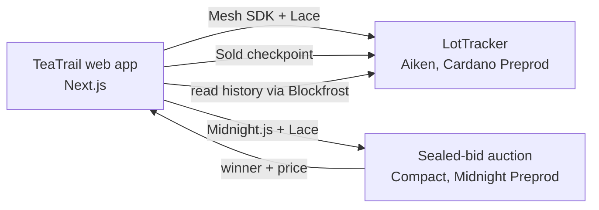

# TeaTrail

**Every lot of Ceylon tea, verified.** Team BlockWeave · UniHack 2026 · Theme: Blockchain for Real-World Adoption

TeaTrail gives each lot of Ceylon tea a tamper-proof **digital passport on Cardano**, from estate to export. Lots
are sold through a **sealed-bid auction on Midnight**, so buyers can trust where the tea came from and bidders
never see each other's prices.

> Status: build phase. Contracts compile and pass tests; the app runs end to end on mock data.
> Chain wiring lands 1–7 Dec.

---

## Who it's for

| User | What they get |
|---|---|
| Estates and smallholders | Proof of origin that earns premium prices |
| Exporters | A traceability certificate per lot, ready for EU Geographical Indication (GI) checks |
| Auction buyers | A fair auction that doesn't leak their pricing strategy |
| Consumers abroad | Scan the QR code on the pack and see the real journey |

## How it's sustained

- Exporters pay a **small fee per certified lot**. They earn it back through premium pricing for verified Ceylon tea.
- Later, we license it to industry bodies (Sri Lanka Tea Board, Colombo Tea Traders' Association) as GI traceability infrastructure.

## Where blockchain and privacy add value

| Need | Why a normal database isn't enough | Chain |
|---|---|---|
| Buyers abroad must trust the record | Whoever runs a database can edit history. A blockchain record can't be quietly changed. | Cardano |
| Many independent parties write to one record | No single company has to be trusted to run it | Cardano |
| Bids must stay secret but provably fair | Zero-knowledge proofs prove the auction was fair without exposing bids | Midnight |

---

## Repo layout

```
contracts/
  cardano/    Aiken: LotTracker (mint + spend, role- and order-checked)   → Person A
  midnight/   Compact: sealed-bid auction                                  → Person B
app/          Next.js web app: estate, checkpoint, auction, scan pages     → Person C
docs/         Team plan, workflow
```

## Run it

```bash
# Web app (mock data, no wallet needed)
cd app && npm install && npm run dev        # http://localhost:3000

# Cardano contracts
cd contracts/cardano && aiken check         # 11 tests

# Midnight contract: see contracts/midnight/README.md
```

Copy `.env.example` to `app/.env.local` for chain settings.

## Demo script (what the judges see)

1. **Estate** mints a lot passport. Switching to the factory and trying to mint gets rejected.
2. **Factory → Broker** add checkpoints. A broker trying to sign the factory step gets rejected by the contract.
3. **Auctioneer** opens a sealed-bid auction. Three bidders bid, and only hashes appear on chain.
4. Reveal: the threshold counts down and the highest sealed bid proves it and wins. Losing bids are never shown.
5. The result is written to the Cardano passport as **Sold**. The **exporter** ships.
6. Scan the QR and see the full, unchangeable journey.

## Architecture



The app reads the Midnight result and writes it to Cardano. That link is app-mediated for the hackathon,
not a trustless bridge.

## Rules

- **Testnets only.** Never commit seed phrases, private keys or API keys. `.env*` is git-ignored.
- Licence: [Apache 2.0](LICENSE).
